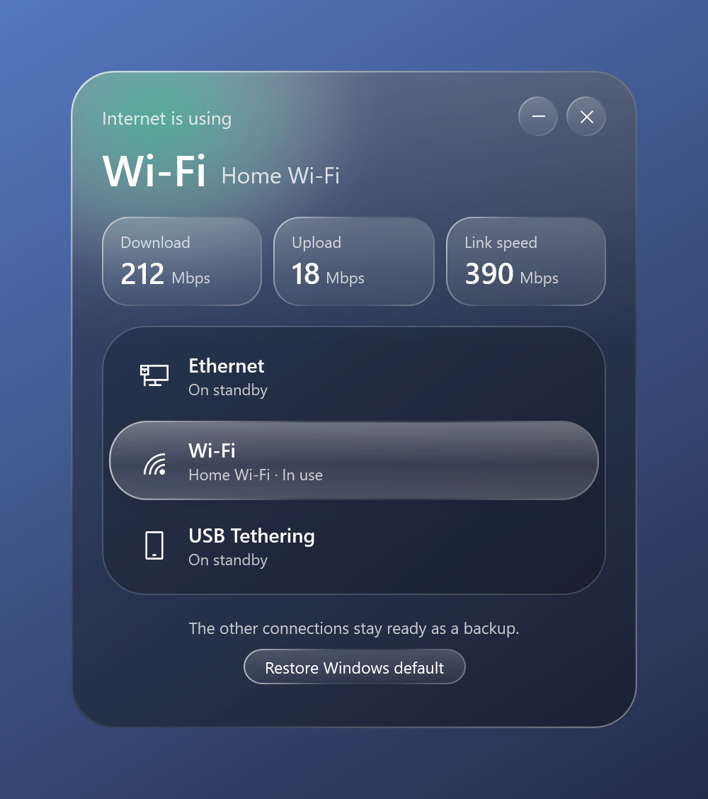

# Network Toggle

A small Windows app for choosing which network connection your PC uses for internet.



When a PC has more than one connection, such as Ethernet and Wi-Fi, Windows sends traffic through just one of them. Network Toggle shows which one is in use and lets you switch with a click. The others stay connected as backups.

## Features

- Lists every active connection: Ethernet, USB Ethernet, Wi-Fi and USB tethering
- Shows the connected Wi-Fi network name
- Shows live download, upload and link speed
- Keeps your choice after a restart
- Restores the Windows default with one click

## Download

Get `Network Toggle.exe` from the [Releases](../../releases) page. It's a single file with nothing to install.

Windows SmartScreen may warn you when you first open it, because the app isn't code-signed. Choose **More info**, then **Run anyway** if you trust the download. You can also build it yourself from the source below.

## Requirements

- Windows 10 version 1803 or later
- .NET Framework 4.5 or later, which is included with Windows 10

Network Toggle has only been tested on Windows 10.

## Use

Open `Network Toggle.exe` and accept the administrator prompt, then click the connection you want. Administrator rights are needed to change network priorities.

Restart any download that was already running, because existing transfers can stay on the old connection.

If Wi-Fi isn't connected, click its row to open the Windows Wi-Fi list and pick a network.

To undo your choice, click **Restore Windows default**.

## How it works

Windows gives each connection a priority number called a metric, and the lowest number wins. The app sets the chosen connection to metric 1 and all the others to 50. These changes are saved in Windows, so they stay in place after you close the app. **Restore Windows default** turns automatic metrics back on.

## Good to know

- **Link speed is not internet speed.** It shows the connection speed between your PC and the next device, such as your router. Use the Download box or a speed test to see your real internet speed.
- **USB tethering is detected from the adapter's name.** Common iPhone and Android adapters are recognised, and others may appear as Ethernet.

## Build from source

No install or Visual Studio is needed. The compiler comes with Windows.

```bat
test.cmd
build.cmd
```

This runs the tests and creates `Network Toggle.exe` in the project folder.

## Contributing

See [CONTRIBUTING.md](CONTRIBUTING.md). To report a security problem, see [SECURITY.md](SECURITY.md).

## License

[MIT](LICENSE)
